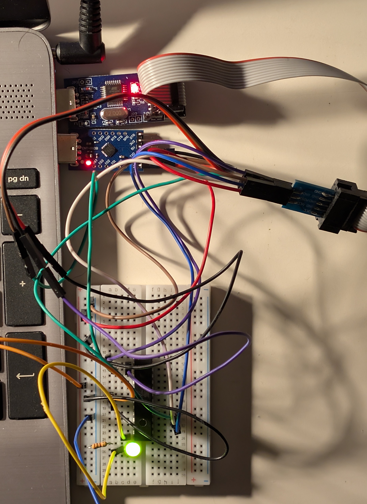
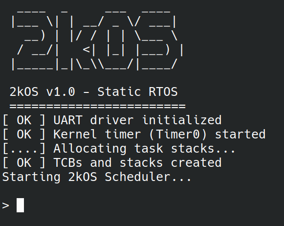

# 2kOS — Minimalist Preemptive RTOS for ATmega328P

2kOS is a custom, lightweight real-time operating system built from scratch for the 8-bit AVR ATmega328P microcontroller.

No `malloc`, no bloated standard libraries, and no Arduino framework. Just raw C, inline AVR assembly, and direct register manipulation.



---

## Core Philosophy & Features

* **100% Static Memory Allocation:** Dynamic memory allocation on a chip with 2 KB of RAM is asking for heap fragmentation and unpredictable hard faults. All task stacks and Task Control Blocks (TCBs) are allocated statically inside a single global `os_heap` array (1024 bytes) during startup.
* **Preemptive Round-Robin Scheduler:** Uses hardware `Timer0` in CTC mode to generate a 1 ms system tick (1000 Hz). The OS automatically saves the current CPU state and switches tasks without requiring tasks to yield manually (though cooperative `os_yield()` and `os_delay()` are also supported).
* **Compile-Time Frequency Scaling:** Originally built and tested on a bare ATmega328P chip running on its internal 1 MHz RC oscillator. However, `timer.c` uses C preprocessor math to automatically calculate timer prescalers and `OCR0A` compare values for 1 MHz, 8 MHz, and 16 MHz targets right at compile time.
* **Software Stack Protection & Kernel Panic:** Since the ATmega328P has no hardware MPU, a task overflowing its stack will silently corrupt adjacent RAM. To catch this, 2kOS places a `STACK_MAGIC_WORD` at the very bottom of every task's stack and fills the empty space with `0xAA` watermark bytes. On every context switch, the scheduler checks the magic word. If it gets overwritten (or if all tasks deadlock, or heap allocation fails), the OS triggers `kernel_panic()`, dumps the crash reason over synchronous UART, waits briefly, and performs a soft reboot (`jmp 0`).
* **Custom Micro-Libc (`helpers.c`):** Standard functions like `sprintf()`, `atoi()`, or `strtok()` eat up way too much Flash and RAM. I wrote custom, lightweight implementations of `_itoa`, `_atoi`, and `_strtok` to handle string tokenization and number formatting for the CLI.
* **PROGMEM Heavy:** Almost all system strings, the ASCII boot logo, CLI command tables, and panic messages are stored in Flash memory so they don't eat up our precious 2 KB of SRAM at startup.
* **Spinlock Mutexes & Power Saving:** Includes basic atomic spinlock mutexes (`os_mutex_lock` / `os_mutex_unlock`) for resource synchronization and a dedicated `idle_task` that puts the CPU into `SLEEP_MODE_IDLE` whenever other tasks are sleeping or suspended.

---

## Interactive CLI (Serial Terminal)

2kOS runs an interactive shell as a dedicated task (`terminal_task` in `cli.c`) with a 256-byte stack..



### Available Commands:
* `help` — lists all available commands.
* `ps` — Lists all currently created tasks and their IDs.
* `memory` — Shows detailed SRAM statistics: unallocated global SRAM, total `os_heap` usage, and the stack usage for each individual task.
* `uptime` — Displays system uptime in minutes and seconds.
* `suspend <id>` — Freezes a running task on the fly by its numeric ID.
* `resume <id>` — Unfreezes a suspended task by its numeric ID.
* `led on` / `led off` — Turns the `PB0` status LED blinking on or off.
* `echo <text>` — Prints back whatever arguments you pass after the command.
* `clear` — Clears the terminal screen and moves the cursor to the top-left.
* `reboot` — Disables interrupts and performs an immediate software reset.

---

## Hardware Setup & Viewing Output

My test setup runs on a bare ATmega328P chip on a breadboard:
* **Clock:** 1 MHz internal RC oscillator (default factory fuses).
* **Status LED:** Connected to pin `PB0` (Pin 14 on the DIP-28 package) with a current-limiting resistor.
* **Programmer:** To flash the compiled kernel to the chip, I use an **APKLVSR USBasp Programmer** along with its 10-pin to 6-pin ISP adapter.
* **Serial Connection:** I use a **WINGONEER CP2104 USB 2.0 to TTL UART adapter**.
* **Baud Rate:** The UART is configured for **4800 baud** (`8N1` frame format).
* **Terminal Software:** To use the CLI, connect with any serial monitor (I use `screen` on Linux) set to **4800 baud**. Example using `screen`:
  ```bash
  screen /dev/ttyUSB0 4800

---

## Building and Flashing

### Prerequisites
Make sure you have the standard AVR toolchain installed:
* `avr-gcc`
* `avr-libc`
* `avr-objcopy`
* `avrdude`
* `make`

### What to Configure Before Building
Depending on your board and programmer, check these settings in the `Makefile` and header files:

1. **`F_CPU` (Clock Speed):**
   In the `Makefile`, `F_CPU` is set to `1000000UL` (1 MHz). If you are running on an 8 MHz setup or a standard 16 MHz Arduino Uno/Nano board, change `F_CPU` in the `Makefile`. `timer.c` will automatically recalculate the `Timer0` prescaler and compare match register at compile time.
2. **`PROGRAMMER` (`Makefile`):**
   Set to `usbasp` by default. If you use a different programmer (like `avrisp`, `usbtiny`, or an Arduino board), update the `PROGRAMMER` variable and add port/baud flags (`-P` / `-b`) to the `flash` target in the `Makefile`.
3. **Slow SCK for 1 MHz Chips (`-B` flag):**
   When flashing a bare chip running at 1 MHz, the SPI programming clock must be under 250 kHz (less than 1/4th of `F_CPU`). If `avrdude` fails to detect the chip, either bridge the "Slow SCK" jumper on your USBasp or add `-B 5` to the `avrdude` command in the `Makefile`:
   ```makefile
   avrdude -c $(PROGRAMMER) -p $(MCU) -B 5 -U flash:w:$(TARGET).hex:i
   ```
4. **Task & Heap Configuration (`include/kernel.h`):**
   `COUNT_TASKS` is set to `3` and `HEAP_LENGTH` is `1024`. If you add new tasks in `main.c`, increment `COUNT_TASKS` and make sure the sum of all task stack sizes stays within `HEAP_LENGTH` — otherwise the kernel will immediately trigger an `"Out of OS Heap!"` or `"Invalid Task ID!"` panic on boot.

### Using the Makefile
```bash
# Compile the project into 2kOS.elf
make

# Generate the 2kOS.hex binary and flash it to the MCU
make flash

# Remove compiled .elf and .hex files
make clean
```

---

## Project Structure

```text
├── include/
│   ├── cli.h         # CLI command struct and terminal task declarations
│   ├── helpers.h     # Custom _itoa, _atoi, and _strtok prototypes
│   ├── idle_task.h   # CPU sleep / idle task header
│   ├── kernel.h      # TCB & Mutex structs, memory settings, kernel API
│   ├── led_task.h    # Blinking status LED task header
│   ├── timer.h       # Timer0 initialization header
│   └── uart.h        # UART baud rate math and driver prototypes
├── src/
│   ├── cli.c         # Interactive shell, PROGMEM command table, command handlers
│   ├── helpers.c     # Lightweight string and number conversion utilities
│   ├── idle_task.c   # Puts the MCU into SLEEP_MODE_IDLE when no tasks are active
│   ├── kernel.c      # Context switching, scheduler, mutexes, kernel panic
│   ├── led_task.c    # Toggles PB0 every 500 ms using os_delay()
│   ├── main.c        # Early boot logs, hardware init, task creation, scheduler start
│   ├── timer.c       # Compile-time frequency math and Timer0 CTC configuration
│   └── uart.c        # Sync/Async UART driver with interrupt-driven RX/TX ring buffers
└── Makefile          # Build and avrdude flash automation
```
